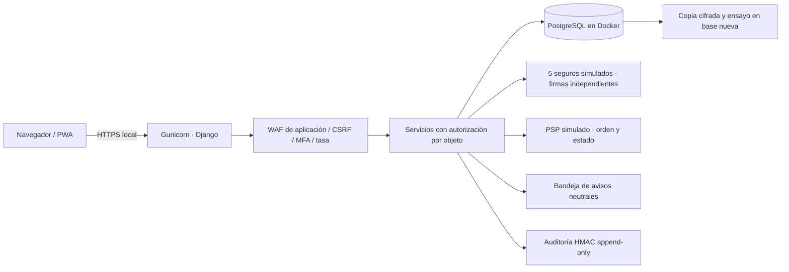

# Guion de demostración y defensa

Este guion recorre el informe completo y vincula acciones visibles, código y evidencia. Los números de **paso de demo** son el orden de exposición; la columna **informe** indica las secciones originales. No confundas la numeración del guion con los capítulos del DOCX.

## Antes de entrar a defender

1. Ejecuta el arranque del README, con Docker disponible. Comprueba `docker compose ps`: la base debe estar `healthy`.
2. Abre https://localhost:8443 y comprueba el certificado local antes de proyectar.
3. Abre `.local/access.md` únicamente para ti; no proyectes contraseñas ni archivos `.env`.
4. Ten dos perfiles de navegador o alterna cuentas cerrando sesión.
5. Ejecuta `.venv/bin/python scripts/check.py`. Abre `evidence/tests.json` y `evidence/concurrency.json`.
6. Genera copia y ensayo de restauración antes de presentar. Abre `evidence/restore.json`.
7. Si la defensa será otro día, repite `scripts/setup.py`: agrega horarios futuros sin borrar los existentes.

**Presentación de 30 segundos:**

> Implementé una plataforma de reservas con datos sintéticos. La búsqueda es pública y la confirmación requiere identidad y MFA. La base de reservas no almacena historias clínicas ni tarjetas. El servidor decide permisos, cupos, cobertura e importe. Los cinco seguros y la pasarela están simulados, pero las firmas, transacciones, restricciones de base y pruebas se ejecutan realmente.

## Paso 1 — Ejecuta el login y demuestra el segundo factor

**Informe:** §2.2, §4.1, S02/S10/S12, R04/R06/R13, P04/P09/P11.

**Ejecuta:** pulsa «Iniciar sesión», entra con `paciente.a` y su contraseña privada. Antes de completar MFA, intenta abrir `/panel/`: no entra. En terminal privada ejecuta:

```bash
.venv/bin/python manage.py demo_code paciente.a
```

Introduce el código. Abre DevTools → Application/Storage → Cookies: `sessionid` debe tener `HttpOnly`, `Secure` y `SameSite=Strict`. Cierra sesión; el token anterior deja de funcionar. Las pruebas P04 y P09 comprueban expiración, revocación, segundo factor y rechazo de códigos ya usados o de otro acceso.

**Defensa:**

> La contraseña usa Argon2id; no se guarda reversible. La sesión está en el servidor y su cookie no aparece en URLs ni es accesible desde JavaScript. Expira a los 30 minutos y puede revocarse. En las cuentas sintéticas el segundo paso utiliza un desafío por acceso: cada login crea un código nuevo, vinculado a esa sesión previa, que se consume al entrar y vence a los cinco minutos. Otro inicio invalida el anterior. La consola simula el canal de entrega del OTP y no es una API de recuperación ni prueba de entrega SMS/correo. Las cuentas nuevas con autenticador conservan TOTP estándar y rechazo de replay.

**Si pregunta si una cookie robada es imposible de reutilizar:**

> Una cookie vigente sigue siendo una credencial portadora. HttpOnly, TLS, SameSite, expiración y revocación reducen exposición y duración; no hacen imposible el robo ni sustituyen la protección del dispositivo. No prometo sesiones mágicamente intransferibles.

## Paso 2 — Busca sin registrarte y muestra minimización

**Informe:** §1, §2.1, §3.1–3.3; S01–S05/S14; R01/R08; P01.

**Ejecuta:** cierra sesión, filtra especialidad, centro y fecha. No se solicita identidad para consultar disponibilidad. Abre «Crear cuenta»: nombre, correo, usuario y contraseña; no hay historia clínica, religión, ingresos, empleador ni contactos del teléfono. Consulta `/privacy/` y `app/models.py`.

**Defensa:**

> El dato más fácil de proteger es el que no se recolecta sin una finalidad necesaria. La agenda puede inferir salud, por eso también se protege; eliminar el expediente clínico de este módulo reduce impacto y superficie. El aviso explica finalidad y plazos, sin consentimiento publicitario ni uso de IA obligatorio. La implementación académica no equivale a una certificación legal.

**Registro nuevo:** crea un usuario ficticio; al primer login escanea el QR con una app autenticadora y verifica su TOTP. No existe recuperación insegura por enlace reutilizable.

## Paso 3 — Reserva, valida seguro y paga

**Informe:** §2.3, §3.1, §4.2–4.3, figuras 2.2/4.2/4.3; S01/S03/S07/S11; R10/R12/R16; P05/P06/P08.

**Ejecuta:** entra con `paciente.a`, elige horario, selecciona una póliza y continúa. Si necesitas otra póliza: «Mi espacio → Vincular póliza», elige una de las cinco aseguradoras y usa una referencia como `DEMO-POLIZA-EXPOSICION`. La orden muestra el importe calculado en servidor; se retiene el horario 15 minutos. Pulsa «Simular pago aprobado»: pasa a confirmada. En otra reserva pulsa «Simular pago denegado»: no queda confirmada y se libera el cupo.

**Defensa:**

> El navegador no decide cobertura, monto ni estado final. El conector valida organización, beneficiario, prestación, scope, firma HMAC, fecha y nonce. El PSP confirma una orden concreta con importe y moneda exactos. No hay PAN ni CVV en formulario, modelo, webhook o base. Una entrega repetida no produce otra cita ni otro cobro.

**Profundización técnica:**

> `reserve()` bloquea al usuario para serializar reintentos y bloquea la franja para serializar competidores. La restricción parcial `one_live_booking_per_slot` impide dos reservas pendientes/confirmadas incluso si una ruta olvidara verificarlo. El pago bloquea la misma franja y la cita, valida la expiración y cambia pago y cita en una transacción. Los importes son centavos enteros para evitar errores de coma flotante.

## Paso 4 — Cancela y verifica el reembolso único

**Informe:** S01/S11/S12, §2.3 y §4.3.

**Ejecuta:** abre una cita pagada y pulsa «Cancelar cita y reembolsar». Consulta el estado y la auditoría. Repetir la cancelación no crea otro reembolso. La prueba `test_P06_payment_then_cancel_refunds_once` lo comprueba.

**Defensa:**

> Cancelar no es borrar la evidencia. Se conserva el estado de la orden y una referencia de reembolso con unicidad por pago. El reembolso es simulado; no afirmo que exista conciliación bancaria real.

## Paso 5 — Intenta leer la cita de otro paciente

**Informe:** §2.2, §5.2–5.3, figura 5.1; R11; P07.

**Ejecuta:** copia la referencia de una cita de `paciente.a`. Cierra sesión y entra como `paciente.b`. Abre `/api/appointments/UUID_DE_A/` o `/appointments/UUID_DE_A/`: responde 403 sin datos. Muestra el evento `request.forbidden` / `authorization.denied` en el panel operador.

**Defensa:**

> Conocer un identificador no autoriza acceso. El UUID dificulta enumerar, pero el control real es filtrar por propietario, centro o profesional antes de devolver cada recurso. Autenticación responde quién eres; autorización responde si puedes acceder a ese objeto.

## Paso 6 — Intenta cruzar centros, profesionales y aseguradoras

**Informe:** §2.2 y §4.2; S07/S08; R02/R10/R17/R20; P02/P05/P07.

**Ejecuta:** entra como `medico.a`: solo agenda asignada, sin importe de pago. `recepcion.a` ve el centro 01 y el estado de sus reservas/cobros, sin datos clínicos. Copia una cita del centro 01 y prueba con `recepcion.b`: 403. En `seguro.1` solo aparecen las coberturas de la aseguradora 1. Prueba `/api/policies/UUID_DE_OTRO_SEGURO/`: 403. Las pólizas propias se muestran por referencia técnica, sin revelar la referencia cifrada.

**Defensa:**

> No existe una cuenta de aseguradora con acceso global a pacientes. Se valida el ámbito organizacional además del rol y además del objeto. El operador tampoco hereda acceso clínico o acceso global a agendas. Una cuenta interna no es sinónimo de permiso universal.

**Gestionar agenda:** desde un profesional o recepción puedes publicar un horario futuro para un profesional de su ámbito. La asignación se valida en servidor; cambiar el ID hacia otro centro se rechaza.

## Paso 7 — Prueba la representación de un menor

**Informe:** S06, §3.2; R03; P03.

**Ejecuta:** con paciente, «Solicitar vínculo», ingresa nombre ficticio, edad y código `DEMO-VINCULO-EXPOSICION`. Sin evidencia, el formulario no crea vínculo. Con evidencia queda pendiente y no aparece como opción habilitada en la reserva. Entra como operador, revisa la solicitud ficticia y marca la revisión para validarla. Vuelve al paciente: ya puede reservar para el dependiente.

**Defensa:**

> Conocer la cédula o el nombre de un menor no demuestra representación. Hay un flujo separado y una validación independiente registrada con actor y fecha. El prototipo verifica evidencia sintética; no simula conectividad con Registro Civil ni certifica tutorías reales. La póliza personal no se extiende silenciosamente al dependiente: en esta demo su reserva es particular hasta disponer de un contrato que lo cubra.

## Paso 8 — Demuestra notificaciones neutrales

**Informe:** S09, §3.1 y §4.2; R09; P10.

**Ejecuta:** después de pago o cancelación, abre «Notificaciones». El único texto es «Tienes una actualización. Ingresa a tu cuenta para consultarla». Reduce el navegador a móvil y muestra `evidence/screenshots/appointment-mobile.png`.

**Defensa:**

> Un aviso visible en una pantalla bloqueada no debe revelar especialidad, diagnóstico ni póliza. El proveedor de mensajería solo necesitaría contacto y plantilla neutral. En el prototipo los avisos se guardan en la bandeja: no hay SMS, correo ni push externo. Una captura del navegador no es una prueba de push real en pantalla bloqueada.

## Paso 9 — Ejecuta ataques de prueba controlados

**Informe:** §5 y §7; P02–P09/P13; R02/R04/R10–R16/R20.

```bash
.venv/bin/python scripts/check.py
```

El runner crea **otra base**, `test_consultas`, ejecuta datos sintéticos y la destruye al terminar. No ataca servicios externos. Los nombres de los casos y sus resultados quedan en `evidence/tests.json`.

| Intento | Control que debes explicar | Evidencia |
|---|---|---|
| Cambiar UUID de cita/póliza | Autorización por objeto y organización | P02/P07 |
| Contraseñas incorrectas repetidas | Cinco intentos por cuenta/5 min y límite por IP, error genérico y alerta | P09 |
| Abrir panel sin segundo factor | Sesión previa sin autenticación completa | P09 |
| Reutilizar sesión revocada/caducada | Sesión en servidor y expiración | P04 |
| Firma inexistente/falsa | Clave individual por conector y HMAC del cuerpo + metadatos | P05/P06 |
| Repetir mensaje firmado | Timestamp de 60 s, nonce único, evento idempotente | P05/P06 |
| Cambiar monto/moneda/evento | Comparación contra orden y transición de estado | P06 |
| Inyección SQL | ORM parametrizado, validación y WAF complementario | P13 |
| XSS almacenado | Escape de plantilla y CSP sin scripts inline | P13 |
| POST desde otro origen | CSRF de Django, SameSite y formulario protegido | P13 |
| Agotar recursos con entradas grandes | Cuerpo ≤32 KiB, campos limitados, timeouts y tasa | WAF / carga |
| Dos reservas del mismo cupo | Bloqueo de fila + restricción única parcial | P08, 100 contendientes |
| Recepción solicita permisos de operador | Control por función y doble aprobación independiente | R20 |

**Defensa si pide «todos los ataques»:**

> Ningún sistema serio garantiza inmunidad total. Definí activos y fronteras, prioricé 20 riesgos y mostré controles con pruebas positivas y negativas. SQLi, XSS, CSRF, BOLA, fuerza bruta, replay, manipulación de pagos y carreras tienen pruebas. Un DDoS volumétrico, un host comprometido o una vulnerabilidad desconocida necesitan otras capas y no quedan resueltos por esta demo local.

**WAF:** el filtro de aplicación bloquea patrones comunes y tamaños indebidos. No es ModSecurity/OWASP CRS ni reemplaza el ORM, el escape, la autorización o un WAF de borde. El patrón bloqueado puede dar falsos positivos; no se inspeccionan contraseñas como si fueran comandos SQL.

## Paso 10 — Muestra los 100 intentos concurrentes

**Informe:** §4.3–4.4, R12, P08.

**Ejecuta:** abre `evidence/concurrency.json`. La prueba utiliza 100 hilos, 100 pacientes distintos, una barrera de inicio y conexiones reales PostgreSQL. Debe registrar exactamente una confirmación y 99 conflictos de negocio. Comprueba que la suite pasó antes de afirmar ese resultado.

**Defensa:**

> No hice una prueba secuencial disfrazada de concurrencia. Los contendientes llegan a una barrera y compiten por el mismo recurso. El resultado se valida tanto en respuestas como en el número real de citas y pagos. La integridad está en PostgreSQL, no en deshabilitar un botón.

## Paso 11 — Auditoría y separación de funciones

**Informe:** S12, §4.1, R06/R18/R20, P11.

**Ejecuta:** abre el panel de `operador.a`: actor, acción, objeto, fecha y resultado. Las acciones de `recepcion.a` y `recepcion.b` tienen actores diferentes. Verifica:

```bash
.venv/bin/python manage.py verify_audit
```

Solicita un cambio de rol sobre una cuenta de personal con operador A. El mismo operador no puede aprobarlo. Operador B sí puede; se cambia el ámbito y se revocan las sesiones de la cuenta modificada. No uses cuentas de pacientes para promoverlas desde este panel.

**Defensa:**

> La auditoría registra consultas, cambios, denegaciones y transferencias/exportaciones. Tiene cadena HMAC y un trigger contra UPDATE/DELETE; el usuario SQL de la web tampoco tiene esos permisos sobre auditoría. La política de roles exige dos cuentas independientes. Un administrador del host y de las claves aún es una frontera de confianza: para resistirlo necesitamos anclaje externo y separación real de infraestructura.

## Paso 12 — Respaldo, caída simulada y restauración

**Informe:** S13, §4.4; R07; P12.

```bash
.venv/bin/python scripts/backup.py backup
.venv/bin/python scripts/backup.py restore-drill
```

**Muestra:** archivo cifrado, checksum verificado, base nueva `restore_...`, recuentos de filas, auditoría válida, sesiones revocadas, tiempo real y antigüedad de la copia en `evidence/restore.json`.

**Defensa:**

> Un backup no está probado hasta restaurarlo. El ensayo crea otra base, valida integridad y aplica retención y supresiones antes de servir tráfico. Mido tiempo y antigüedad de copia frente a RTO 4 h y RPO 1 h. La antigüedad es una cota de la ventana potencial de pérdida, no una medición de todas las transacciones perdidas. El ensayo no destruye datos de la aplicación.

**Si pregunta por servidor único:**

> Tres procesos web no son tres servidores. Esta entrega local conserva un punto único de fallo de host y una sola instancia PostgreSQL. Las copias cifradas locales ayudan ante corrupción, pero el respaldo aislado exige otro disco/host y otra custodia de clave. Producción necesita replicación, balanceador, almacenamiento externo y simulacro de pérdida completa. El informe los plantea como objetivos, no como garantías ya logradas.

## Paso 13 — Vence una retención y demuestra los derechos

**Informe:** S14, §3.2; R08/R19; P14.

**Ejecuta:** con paciente, «Descargar mis datos» exporta solo su información. «Cerrar mi cuenta» exige cancelar citas activas, deshabilita la cuenta y cierra sesión. La prueba P14 coloca una cuenta ficticia fuera de plazo y comprueba su disociación; otra con retención legal no se purga.

```bash
.venv/bin/python manage.py maintenance
.venv/bin/python scripts/audit_retention.py
```

**Defensa:**

> Cerrar cuenta no significa eliminar comprobantes sujetos a conservación. La cuenta se disocia a 365 días del cierre, las citas operativas vencidas sin cobro a 730 días y los avisos a 30 días. La auditoría tiene purga de prefijo a 365 días con ancla HMAC, ejecutada por propietario separado del rol web. Los registros financieros quedan conservados hasta definir obligación aplicable. Las copias locales rotan a 24 h y los marcadores de supresión se reaplican al restaurar; una copia externa fuera de esta política requiere coordinación adicional.

## Paso 14 — Explica capacidad, arquitectura y resultados

**Informe:** §4 completo, §7.1 y §8.

**Muestra:** `compose.yaml`, `app/models.py`, migraciones, `evidence/load-*.json`, `docs/VALIDACION.md` y el esquema siguiente.



**Defensa:**

> Elegí Django para reducir código propio en sesiones, CSRF, validación y escape; PostgreSQL aporta transacciones, bloqueos y restricciones. La UI responsive comparte una sola lógica para escritorio y móvil. Los contratos de conectores se pueden sustituir, pero hoy corren localmente y no tienen latencia de proveedor externo. No confundo 2.000 cuentas, 2.000 usuarios virtuales con pausas y 2.000 peticiones simultáneas.

El informe menciona JMeter: se incluye `docs/capacidad.jmx` como plan reproducible. Las mediciones ejecutadas aquí usan el runner local y se identifican como tales; no se presentan como un informe de JMeter.

## Preguntas rápidas que puede hacer el docente

**¿Qué es confidencialidad, integridad y disponibilidad aquí?** Confidencialidad: cada ámbito ve lo propio y se minimiza el dato. Integridad: monto, estado y cupo no los decide el cliente; firmas y transacciones. Disponibilidad: cuotas, timeouts, copias y recuperación medida, con limitaciones de host local.

**¿Cómo aplicaste STRIDE?** Suplantación: MFA/sesión. Manipulación: HMAC y montos. Repudio: actor y auditoría. Divulgación: autorización y minimización. DoS: tasa y límites. Elevación: control de función, ámbito y doble revisión.

**¿Por qué no basta JWT?** Un formato de token no autoriza por objeto ni impide cupos duplicados. Se eligió sesión de servidor por revocación sencilla en la demo.

**¿Por qué HMAC y no solo HTTPS?** TLS protege el canal; la firma vincula emisor autorizado, scope, fecha, nonce y cuerpo. El nonce evita repetición y la clave de operación resuelve reintentos legítimos. HMAC no cifra el mensaje ni protege si se compromete su clave.

**¿Cómo se controla SSRF?** No hay una URL de proveedor suministrada por el cliente ni un fetch arbitrario. Los conectores son adaptadores locales con destino fijo. Al sustituirlos por HTTP se deben imponer allowlist, timeout, validación de respuesta y presupuesto de reintentos.

**¿Y ejecución de comandos, path traversal o archivos peligrosos?** No existe subida de archivos ni ejecución de comandos del usuario; no se interpolan entradas en shell. Las evidencias son referencias ficticias con hash. Las rutas de backup las controla la consola operativa, no un parámetro HTTP.

**¿Las claves están en Git?** Se generan al preparar y se guardan en `.env`/`.local`, con permisos privados y exclusión de Git. La web no publica secretos. No es un Vault externo; la custodia local no resiste un host comprometido. Rotar claves de campo requiere recifrar los datos, no borrar el archivo.

**¿Está toda la base cifrada?** Se cifran las referencias de póliza y los secretos MFA; los backups completos se cifran. No se implementó cifrado transparente del volumen PostgreSQL. Para cifrado total en reposo se requiere disco/volumen cifrado y custodia externa de claves. La conexión de la base local usa loopback con SCRAM, sin atribuirle TLS de PostgreSQL.

**¿Es legal almacenar un diagnóstico si el paciente acepta?** El diseño no lo necesita y no lo permite en el esquema de reserva. Consentimiento no elimina minimización ni reemplaza otras obligaciones. Para un sistema real se valida la base legitimadora, conservación y tratamiento especial con los responsables competentes.

**¿Bajaron todos los riesgos a bajo?** No. Los residuales de la Tabla 5.3 son hipótesis del informe. La evidencia confirma escenarios concretos; continuidad de host, proveedores, legitimación real de menores y carga máxima conservan trabajo pendiente.

**¿Dónde está MITRE ATT&CK?** En `docs/MATRIZ_CUMPLIMIENTO.md`: T1110.004, T1078, T1539, T1199, T1552.001, T1499.003, T1485 y T1098. Son comportamientos del atacante relacionados con riesgos; no son certificaciones ni una lista de controles. La minimización y retención son decisiones de privacidad, no se fuerzan a una técnica ATT&CK.

**Cierre sugerido:**

> Conservamos el valor del servicio: encontrar médico, reservar, validar cobertura y pagar. Eliminamos la recolección excesiva y probamos los controles más importantes con datos sintéticos. Los resultados y sus límites quedan visibles: una defensa sólida se basa en evidencia reproducible, no en asegurar que ningún ataque será posible.


## Código nuevo en cada inicio de las cuentas de ensayo

Después de salir, vuelve a introducir usuario y contraseña y ejecuta `demo_code` otra vez. El nuevo desafío usa otro código inmediatamente; no hay que esperar 30 segundos. Un código consumido, vencido, revocado o de otra sesión previa no abre el panel. El comando sin un login pendiente válido devuelve una indicación para iniciar primero. El desbloqueo de ensayo, si se agota el límite, es `manage.py demo_unlock paciente.a`, exclusivo de consola local y auditado. Los intentos fallidos siguen limitados; un MFA exitoso limpia el contador de esa cuenta.
